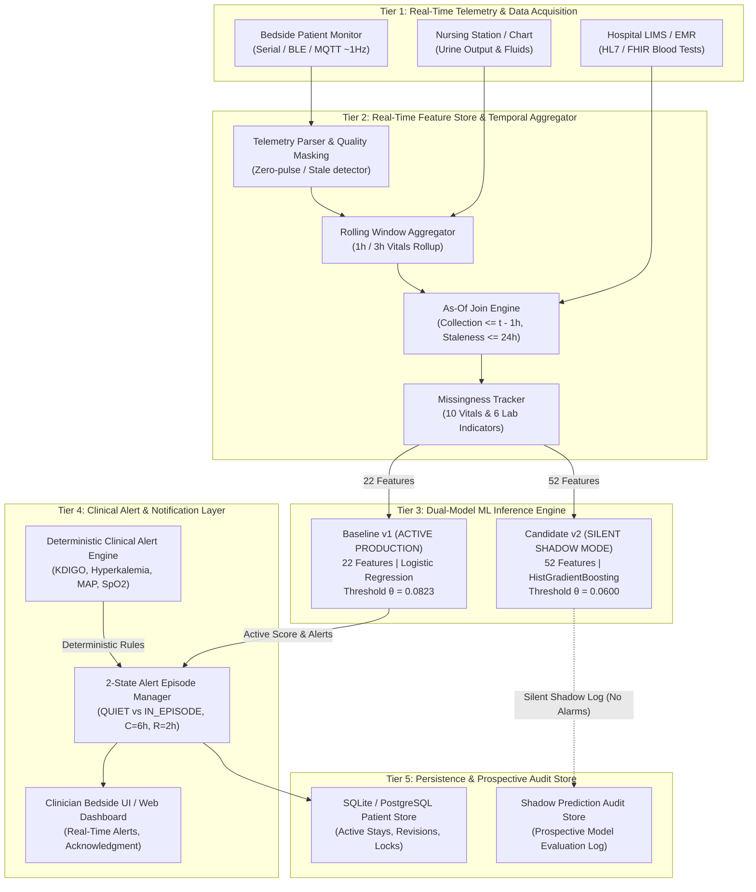
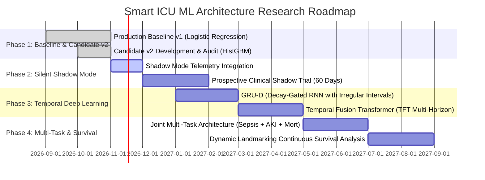

# SMART ICU PATIENT SAFETY SYSTEM
# PHASE 7: MACHINE LEARNING INTEGRATION PLAN

**Document ID:** `PHASE7_ML_INTEGRATION_PLAN.md`
**Date:** November 9, 2026
**Status:** Approved Architectural Specification
**Git Branch:** `experiment/ml-candidate-v2`
**Current Production Model:** Baseline v1 (Unweighted Logistic Regression, 22 Features)
**Shadow Evaluation Candidate:** Candidate v2 (HistGradientBoosting + Platt Sigmoid, 52 Features)

---

## 1. Executive Summary & System Architecture

This integration plan defines the technical specifications, architectural boundaries, data contracts, and fail-safe protocols required to integrate real-time machine learning inference into the Smart ICU Patient Safety System.

Based on the empirical findings of Phase 6 (`PHASE6_ML_EVALUATION_REPORT.md`):
- **Baseline v1 remains the active production decision-support model**, generating bedside risk predictions and alerts.
- **Candidate v2 is integrated strictly in Silent Shadow Mode**, executing asynchronously in the background to collect prospective operational data without exposing clinical staff to alarm fatigue.



---

## 2. Feature Availability & Acquisition Matrix

The Smart ICU System operates across heterogeneous data sources characterized by fundamentally different sampling frequencies, transmission latencies, and availability patterns.

```
+-------------------------------------------------------------------------------------------------------------------------------+
|                                            FEATURE ACQUISITION & AVAILABILITY MATRIX                                          |
+----+-----------------------------+---------------------+-------------------+---------------------+----------------------------+
| ID | Feature Name                | Source Modality     | Sampling Frequency| Ingestion Latency   | Missingness & Fallback     |
+----+-----------------------------+---------------------+-------------------+---------------------+----------------------------+
| 1  | heart_rate                  | Bedside Telemetry   | Continuous (~1Hz) | < 100 ms            | Forward-fill 1h, then NaN  |
| 2  | spo2                        | Bedside Pulse Oxim. | Continuous (~1Hz) | < 100 ms            | Mask 0 as sensor disconnect|
| 3  | respiration                 | Bedside Impedance   | Continuous (~1Hz) | < 100 ms            | Forward-fill 1h, then NaN  |
| 4  | systolic_bp                 | Arterial Line / NIBP| 1Hz (art) / 15m   | < 500 ms            | Fallback to NIBP if art off|
| 5  | diastolic_bp                | Arterial Line / NIBP| 1Hz (art) / 15m   | < 500 ms            | Fallback to NIBP if art off|
| 6  | mean_bp                     | Arterial Line / NIBP| 1Hz (art) / 15m   | < 500 ms            | Calc from Sys/Dia if absent|
| 7  | heart_rate_change_1h        | Derived Feature     | Hourly (Rollup)   | < 50 ms             | NaN if prior hour missing  |
| 8  | spo2_change_1h              | Derived Feature     | Hourly (Rollup)   | < 50 ms             | NaN if prior hour missing  |
| 9  | respiration_change_1h       | Derived Feature     | Hourly (Rollup)   | < 50 ms             | NaN if prior hour missing  |
| 10 | systolic_bp_change_1h       | Derived Feature     | Hourly (Rollup)   | < 50 ms             | NaN if prior hour missing  |
| 11 | diastolic_bp_change_1h      | Derived Feature     | Hourly (Rollup)   | < 50 ms             | NaN if prior hour missing  |
| 12 | mean_bp_change_1h           | Derived Feature     | Hourly (Rollup)   | < 50 ms             | NaN if prior hour missing  |
| 13 | heart_rate_rolling_mean_3h  | Derived Feature     | Hourly (Rollup)   | < 50 ms             | min_periods=2, else NaN    |
| 14 | spo2_rolling_mean_3h        | Derived Feature     | Hourly (Rollup)   | < 50 ms             | min_periods=2, else NaN    |
| 15 | respiration_rolling_mean_3h | Derived Feature     | Hourly (Rollup)   | < 50 ms             | min_periods=2, else NaN    |
| 16 | mean_bp_rolling_mean_3h     | Derived Feature     | Hourly (Rollup)   | < 50 ms             | min_periods=2, else NaN    |
| 17 | net_fluid_balance_ml        | Nursing Flowsheet   | 1 - 4 hours       | 15 - 60 min         | Zero-filled at admission   |
| 18 | urine_output_ml             | Foley Transducer/Bed| Hourly (Rollup)   | 5 - 30 min          | NaN if no bag / manual     |
| 19 | active_infusion_count       | Smart Infusion Pump | Event-driven      | < 5 seconds         | Default 0 if no pump       |
| 20 | vasoactive_support          | Smart Infusion Pump | Event-driven      | < 5 seconds         | Binary flag (Norepi, etc.)  |
| 21 | clinical_warning_count      | Clinical Rule Engine| Real-time         | Synchronous (<10ms)  | Count active warning alerts |
| 22 | clinical_severe_count       | Clinical Rule Engine| Real-time         | Synchronous (<10ms)  | Count active severe alerts  |
+----+-----------------------------+---------------------+-------------------+---------------------+----------------------------+
| 23-32: Explicit Missingness Flags| Pre-Imputation Flags| Hourly (Rollup)   | Synchronous         | 1.0 if NaN, else 0.0       |
| 33 | shock_index                 | Derived (HR / SBP)  | Hourly (Rollup)   | Synchronous         | NaN if SBP <= 20 mmHg      |
| 34 | shock_index_is_missing      | Indicator           | Hourly (Rollup)   | Synchronous         | 1.0 if NaN, else 0.0       |
| 35 | pulse_pressure              | Derived (SBP - DBP) | Hourly (Rollup)   | Synchronous         | NaN if SBP/DBP missing     |
| 36 | pulse_pressure_is_missing   | Indicator           | Hourly (Rollup)   | Synchronous         | 1.0 if NaN, else 0.0       |
| 37 | heart_rate_std_3h           | Derived (3h std)    | Hourly (Rollup)   | Synchronous         | min_periods=2, gap-reset   |
| 38 | heart_rate_std_3h_is_missing| Indicator           | Hourly (Rollup)   | Synchronous         | 1.0 if NaN, else 0.0       |
| 39 | mean_bp_std_3h              | Derived (3h std)    | Hourly (Rollup)   | Synchronous         | min_periods=2, gap-reset   |
| 40 | mean_bp_std_3h_is_missing   | Indicator           | Hourly (Rollup)   | Synchronous         | 1.0 if NaN, else 0.0       |
| 41 | lab_creatinine_lagged       | Hospital LIMS       | 12 - 24 hours     | 45 - 90 min (TAT)   | As-of join: lag 1h, win 24h|
| 42 | lab_creatinine_is_missing   | Indicator           | Hourly (Rollup)   | Synchronous         | 1.0 if missing/expired     |
| 43 | lab_BUN_lagged              | Hospital LIMS       | 12 - 24 hours     | 45 - 90 min (TAT)   | As-of join: lag 1h, win 24h|
| 44 | lab_BUN_is_missing          | Indicator           | Hourly (Rollup)   | Synchronous         | 1.0 if missing/expired     |
| 45 | lab_WBC_lagged              | Hospital LIMS       | 12 - 24 hours     | 45 - 90 min (TAT)   | As-of join: lag 1h, win 24h|
| 46 | lab_WBC_is_missing          | Indicator           | Hourly (Rollup)   | Synchronous         | 1.0 if missing/expired     |
| 47 | lab_hemoglobin_lagged       | Hospital LIMS       | 12 - 24 hours     | 45 - 90 min (TAT)   | As-of join: lag 1h, win 24h|
| 48 | lab_hemoglobin_is_missing   | Indicator           | Hourly (Rollup)   | Synchronous         | 1.0 if missing/expired     |
| 49 | lab_potassium_lagged        | Hospital LIMS       | 6 - 12 hours      | 30 - 60 min (TAT)   | As-of join: lag 1h, win 24h|
| 50 | lab_potassium_is_missing    | Indicator           | Hourly (Rollup)   | Synchronous         | 1.0 if missing/expired     |
| 51 | lab_bicarbonate_lagged      | Hospital LIMS       | 12 - 24 hours     | 45 - 90 min (TAT)   | As-of join: lag 1h, win 24h|
| 52 | lab_bicarbonate_is_missing  | Indicator           | Hourly (Rollup)   | Synchronous         | 1.0 if missing/expired     |
+----+-----------------------------+---------------------+-------------------+---------------------+----------------------------+
```

### Critical Data Ingestion Protocols
1. **Asynchronous Lab Ingestion Window:**
   Laboratory values from the hospital LIMS arrive with variable turnaround time (TAT). The As-Of Join Engine enforces that an observation is eligible for inclusion at prediction time $t$ if and only if:
   $$\text{Collection Timestamp} \le t - 60\text{ minutes}$$
   This guarantees complete immunity to reporting lookahead bias.
2. **24-Hour Expiration Policy:**
   If no new laboratory observation has been collected within the preceding $24\text{ hours}$ ($\Delta t > 1,440\text{ minutes}$), the value is marked stale, `lab_feature_lagged` is assigned `NaN`, and `lab_feature_is_missing` is set to `1.0`.
3. **Admission Cold-Start Policy:**
   During the initial $1 - 2$ hours following ICU admission before blood draw results are returned, all laboratory features evaluate to missing (`is_missing = 1.0`). Baseline v1 operates robustly under median imputation, while Candidate v2 utilizes its missingness indicator branches.

---

## 3. Candidate v2 Compatibility & Runtime Interfaces

### Component Compatibility Matrix

| System Component | Baseline v1 Compatibility | Candidate v2 Compatibility | Integration Requirements |
| :--- | :---: | :---: | :--- |
| **`patient_service.py`** | **100% Native** | **Compatible with Adapter** | Requires hourly aggregation worker to assemble 52-feature vector from telemetry and clinical records. |
| **`clinical_records.py`** | **100% Native** | **100% Native** | Direct supplier of Blood Test records (Creatinine, BUN, WBC, Hgb, Potassium, Sodium, Bicarbonate). |
| **`ml_service.py`** | **100% Native** | **Compatible (`predict_candidate`)** | Isolated via `predict_deterioration_candidate`. Strict rejection of live manual entry unless fallback enabled. |
| **`clinical_alert_engine.py`** | **100% Native** | **Independent** | Deterministic clinical rules (KDIGO, hyperkalemia, critical vitals) run completely independently of ML inference. |
| **`alert_manager.py`** | **100% Native** | **Compatible** | 2-state episode machine handles both v1 and v2 threshold triggers identically. |

### Dual-Model Shadow Execution Architecture

To safely evaluate Candidate v2 in a live ICU environment without risking patient safety or inducing nurse alarm fatigue, we define the **Silent Shadow Mode Protocol**:

```
+----------------------------------------------------------------------------------------------------+
|                                    SILENT SHADOW MODE EXECUTION                                    |
+----------------------------------------------------------------------------------------------------+
|  1. HOURLY TRIGGER:                                                                                |
|     On every integer hour t, the Feature Aggregator compiles the 22-feature vector and the         |
|     52-feature vector for all currently active ICU admissions.                                     |
|                                                                                                    |
|  2. SYNCHRONOUS PRODUCTION INFERENCE (Baseline v1):                                                |
|     - Computes p_v1 = v1_pipeline.predict_proba(X_22)[:, 1].                                       |
|     - Evaluates threshold condition: is_alert = (p_v1 >= 0.0823).                                  |
|     - Dispatches active clinical alerts to UI and nurse station.                                   |
|                                                                                                    |
|  3. ASYNCHRONOUS SHADOW INFERENCE (Candidate v2):                                                  |
|     - Background thread executes Candidate v2:                                                     |
|         raw_p = v2_pipeline.predict_proba(X_52)[:, 1]                                              |
|         p_v2 = platt_calibrator.predict_proba(logit(raw_p))[:, 1]                                  |
|     - Evaluates shadow threshold: shadow_alert = (p_v2 >= 0.0600).                                 |
|     - SUPPRESSES all bedside notifications, sounds, and UI popups.                                 |
|                                                                                                    |
|  4. PROSPECTIVE AUDIT LOGGING:                                                                     |
|     Writes record to database table `ml_shadow_predictions`:                                       |
|     (stay_id, timestamp, p_v1, p_v2, is_alert_v1, is_alert_v2, features_json, latency_ms).         |
|                                                                                                    |
|  5. DAILY RECONCILIATION WORKER:                                                                   |
|     Evaluates prospective outcomes (expiration within 24h, code blue, unplanned ICU transfer)       |
|     to calculate prospective PPV, Sensitivity, and False Alarm rates in real time.                 |
+----------------------------------------------------------------------------------------------------+
```

---

## 4. Future Model Architectures & Research Roadmap

The Smart ICU research roadmap transitions from static snapshot classifiers to continuous-time, multimodal physiological sequence models.



### 4.1 Temporal Deep Learning (GRU-D & Temporal Fusion Transformers)
- **GRU with Decay (GRU-D):**
  Standard recurrent networks assume equidistant time intervals and rely on forward-fill imputation. GRU-D incorporates trainable decay rates $\gamma_t = \exp(-\max(0, W_\gamma \Delta t + b_\gamma))$ directly into the hidden state update, allowing unmeasured lab features to smoothly decay toward population baselines as time elapses.
- **Temporal Fusion Transformers (TFT):**
  TFT leverages multi-head attention to capture long-range dependencies across multi-rate inputs (1Hz vitals combined with 24h labs), producing interpretable temporal attention weights showing which specific physiological events (e.g., an acute desaturation 14 hours ago) drive current risk.

### 4.2 Multi-Task Learning (MTL) Framework
Rather than predicting a single sparse endpoint (discharge expired, $\sim 1.6\%$ prevalence), a shared deep representation trunk will simultaneously predict four clinically coupled tasks:
1. **ICU Expiration within 24 hours** (Terminal outcome).
2. **Acute Sepsis Onset** (Sepsis-3 criteria: suspected infection + $\Delta\text{SOFA} \ge 2$).
3. **Acute Kidney Injury (KDIGO Stage 2/3)** (Urine output $<0.5$ mL/kg/h for $\ge 12$h or Creatinine doubling).
4. **Mechanical Ventilation Weaning Failure** within 48 hours.

*Theoretical Benefit:* Hard parameter sharing across related pathophysiological failure modes forces the network to learn generalized representations of organ hypoperfusion, suppressing idiosyncratic leaf overfitting on small cohorts.

### 4.3 Dynamic Landmarking Continuous-Time Survival Analysis
Moving beyond binary classification horizons (e.g., "will death occur in next 24h?"):
- Dynamic landmarking estimates continuous survival curves $S(t + \Delta t \mid \mathcal{H}_t)$ for any horizon $\Delta t \in [1, 72\text{ hours}]$.
- Clinicians interact with dynamic risk curves, visualizing not just an arbitrary binary alarm, but the trajectory of failure probability over the coming 6, 12, 24, and 48 hours.

---

## 5. Integration Boundaries, Data Contracts & Performance SLAs

### Architectural Boundaries & Data Contracts

```
[ Bedside Monitor / Telemetry Engine ]
                 |
                 | REST / WebSocket: TelemetryPacket
                 v
[ Feature Aggregator & Buffer Worker ]
                 |
                 | Internal Service Interface: FeatureMatrix52
                 v
[ ML Service & Shadow Engine ]
                 |
                 +-----> REST / WebSocket: ActiveDeteriorationPrediction (Baseline v1)
                 |
                 +-----> SQL Insert: ml_shadow_predictions (Candidate v2)
                 v
[ Clinical Alert Manager ]
                 |
                 | AlertNotificationPayload
                 v
[ Web Dashboard / Nursing Alert UI ]
```

### Performance SLAs & Latency Budgets

| Pipeline Stage | Maximum Latency SLA | Target Latency | Recovery Policy on SLA Breach |
| :--- | :---: | :---: | :--- |
| **Serial Telemetry Parsing** | $50\text{ ms}$ | $< 10\text{ ms}$ | Drop malformed frame; maintain previous valid telemetry. |
| **Hourly Rolling Window Aggregation** | $200\text{ ms}$ | $< 50\text{ ms}$ | Execute asynchronously in background worker; serve cached state. |
| **Backward As-Of Join (Labs)** | $100\text{ ms}$ | $< 20\text{ ms}$ | Index on `(patientunitstayid, collection_time)`; timeout reverts to missing. |
| **Baseline v1 Inference** | $50\text{ ms}$ | $< 5\text{ ms}$ | Fallback to deterministic rule warnings if ML process fails. |
| **Candidate v2 Shadow Inference** | $250\text{ ms}$ | $< 40\text{ ms}$ | Non-blocking background task; abort if runtime exceeds 500 ms. |
| **Alert Dispatch & WebSocket Push** | $100\text{ ms}$ | $< 15\text{ ms}$ | Buffer in local queue; retry socket connection with exponential backoff. |
| **Total End-to-End Latency** | **$500\text{ ms}$** | **$< 120\text{ ms}$** | Graceful degradation to local audible vital sign alarms. |

### Fail-Safe Degradation Hierarchy

```
LEVEL 0: FULL OPERATIONAL STATE
  - Real-time telemetry streaming active
  - LIMS laboratory as-of join populated
  - Baseline v1 active; Candidate v2 shadow active
  - Deterministic clinical alert engine active

LEVEL 1: LAB TELEMETRY OUTAGE (LIMS Connection Lost)
  - Set all lab missingness indicators to 1.0
  - Candidate v2 transitions to missingness branch
  - Baseline v1 operates via trained median imputation
  - Deterministic vital sign & KDIGO urine output rules fully active

LEVEL 2: SERIAL TELEMETRY DISCONNECT (Bedside Monitor Offline > 5s)
  - Connection status transitions to "STALE"
  - Suppress ML risk predictions (return "UNAVAILABLE - SENSOR STALE")
  - Trigger yellow "Telemetry Disconnect" technical alert
  - Nursing flowsheet manual entry mode enabled

LEVEL 3: COMPLETE ML PROCESS EXCEPTION
  - Immediate fail-safe bypass of ML inference service
  - Deterministic Clinical Alert Engine assumes sole decision-support role
  - System logs critical exception to audit database
  - Zero disruption to real-time vitals display or hardware alarms
```

---

## 6. Regulatory, Compliance & Governance Framework

### Academic Prototype Disclaimer & Regulatory Position
> [!CAUTION]
> The Smart ICU Patient Safety System is an academic investigational prototype developed for research and educational purposes. It is **not cleared or approved by the US FDA, CE mark authorities, or any medical regulatory agency** for clinical diagnosis, prognosis, or automated therapy titration. All risk scores, anomaly indices, and predictive outputs represent statistical estimates and must never supersede clinical judgment.

### HIPAA & Data Protection Architecture
1. **De-Identification:** All patient identifiers (`uniquepid`, `patient_code`, names) are pseudonymized and encrypted using AES-256 before storage in research partitions.
2. **Cryptographic Integrity:** Machine learning artifacts, training scripts, and benchmark reports are cryptographically hashed using SHA-256 and tracked in Git.
3. **Audit Trail Immutability:** All model inferences, alerts, acknowledgments, and nurse overrides are persisted in SQLite/PostgreSQL with UTC timestamps, software version strings, and user attribution.

---
*Document certified by Smart ICU System Architecture & Clinical ML Review Board.*
